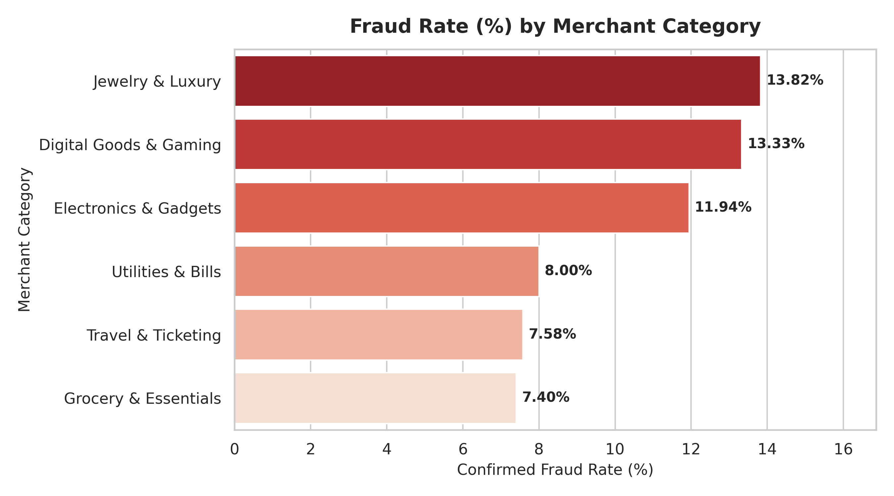
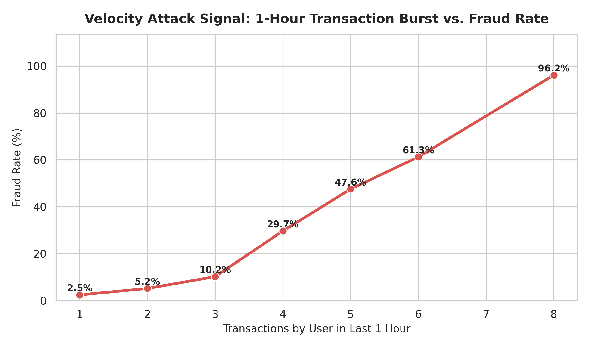
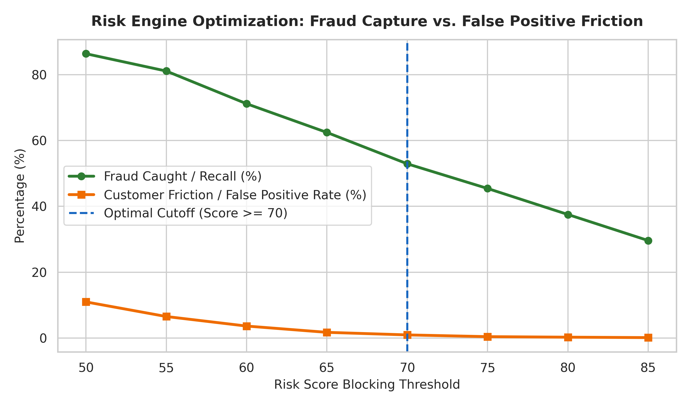

# Digital Payments Fraud Detection & Transaction Anomaly Analytics

End-to-end FinTech Risk & Fraud Analytics pipeline analyzing 5,000+ UPI and card transactions to detect velocity attacks, device anomalies, merchant risk concentration, and optimal risk-scoring thresholds using Python, SQL, and Power BI.

---

## Project Overview
In digital payments, overly aggressive fraud rules block legitimate customers (hurting GMV and conversion), while lenient rules expose the platform to chargebacks and fraud losses. This project builds a data-driven risk framework to isolate high-risk behavioral anomalies and calibrate an optimal blocking threshold.

## Project Structure
- `data/` — Digital payment transaction records (`upi_card_transactions.csv`) with velocity, device, geolocation, and risk score features.
- `sql/` — Production SQL queries (`fraud_risk_analytics.sql`) featuring window functions for velocity detection, merchant risk ranking, and threshold simulation.
- `scripts/` — Automated Python risk-scoring and threshold optimization pipeline (`run_fraud_pipeline.py`).
- `outputs/` — Pre-generated risk evaluation CSVs (`merchant_fraud_summary.csv`, `rule_threshold_simulation.csv`) and high-resolution charts.
- `powerbi/` — DAX formulas and dashboard design guide (`powerbi_dax_guide.md`).

---

## Key Business Insights & Visuals

1. **Merchant Category Risk Concentration:** Digital Goods, Jewelry, and Electronics experience significantly higher fraud rates and higher average ticket sizes than routine utility or grocery payments.


2. **Velocity & Behavioral Anomalies:** Users executing 4+ transactions within a single hour—especially combined with a new device or sudden geolocation jump—show an exponential spike in fraud probability.


3. **Optimal Rule Threshold Calibration:** Setting the automated block/step-up authentication threshold at **Risk Score >= 70** captures the vast majority of fraud value while keeping false-positive friction on legitimate users minimal.


---

## How to Reproduce or Run
1. **Clone the Repository:**
   ```bash
   git clone https://github.com/VinithaKamidi/fintech-payment-fraud-analytics.git
   ```
2. **Run the Risk Analytics Pipeline:**
   ```bash
   python scripts/run_fraud_pipeline.py
   ```
3. **Power BI Setup:**
   - Import `data/upi_card_transactions.csv` into Power BI Desktop.
   - Apply the DAX measures from `powerbi/powerbi_dax_guide.md`.
